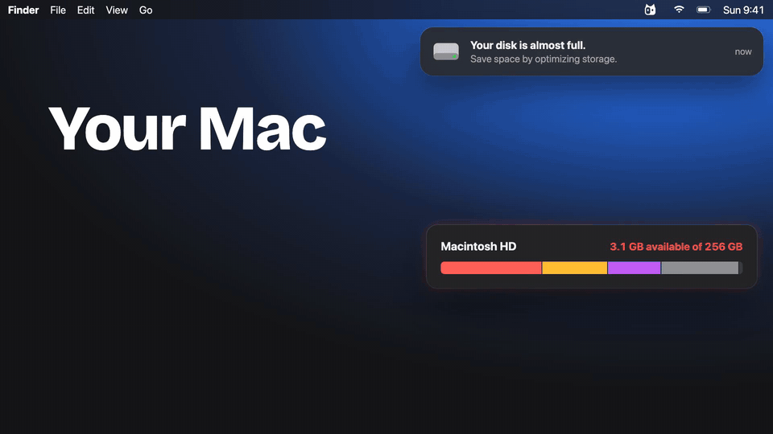

# Kitty Finder

**Your cloud drives in Finder, without filling up your Mac.**

Kitty Finder is a small, free and open-source menu bar app for macOS. It puts
your Google Drive into Finder as a normal-looking drive. Every file and folder
is there to browse, but a file is only downloaded when you open it, and copies
you haven't used for a while are cleared automatically. Your Mac keeps its
free space; your files stay in the cloud.

<p align="center"></p>

<p align="center">
  <a href="https://cdn.jsdelivr.net/gh/redwan-cpp/Kitty-finder@main/docs/media/kitty-finder-intro.mp4"></a>
  <br>
  <sub>▶︎ <a href="https://cdn.jsdelivr.net/gh/redwan-cpp/Kitty-finder@main/docs/media/kitty-finder-intro.mp4">Watch the 30-second intro with sound</a></sub>
</p>

---

## The problem: Macs run out of space

- **The storage can't be upgraded.** On Apple silicon Macs the SSD is part of
  the main board. Whatever size you bought is what you have for the life of
  the machine, and choosing more at purchase time is expensive. Base models
  have often shipped with 256 GB.
- **Much of it is gone before you save anything.** macOS, its system data,
  apps, caches and updates take a large share of a small disk.
- **Meanwhile, cloud space sits unused.** Many people have one or more Google
  accounts (personal, school, work), each with at least 15 GB of free Drive
  storage, but using it means visiting a website or running a sync app.
- **Syncing makes it worse.** A classic sync folder copies the cloud onto the
  Mac, which is the opposite of what a full Mac needs. macOS's own "Optimize
  Mac Storage" only applies to iCloud Drive.

The result: "Your disk is almost full", deleting things you'd rather keep, or
carrying an external drive.

## The solution: Kitty Finder

| | |
|---|---|
| **Right in Finder** | Each Google account appears as its own drive under `~/Kitty Finder` (and in Finder's sidebar). Open, save, rename, move, copy and delete as usual. |
| **Downloads on demand** | Nothing is copied to your Mac until you open it. Large files only download the parts that are read, so videos start playing straight away. |
| **Space stays free** | You choose how much space downloaded copies may use (10 GB by default). The least-recently-used ones are cleared automatically; they stay in the cloud. One click ("Free Up Space") clears them all. |
| **Edits upload in the background** | Saving finishes at disk speed; the upload happens afterwards. The menu bar shows `↑3` while files are uploading. |
| **Works offline** | Right-click a folder → **Keep Offline**. Its files stay on your Mac and open with no internet, even after a restart; edits upload when you're back online. |
| **Several accounts** | Add as many Google accounts as you like, and give each drive your own name. |
| **Updates itself** | Kitty Finder checks GitHub once a day and installs new versions in place, after checking the download against GitHub's checksum. |
| **Google Docs too** | Docs, Sheets and Slides appear as links that open in your browser. |
| **Private** | Kitty Finder talks to Google directly from your Mac. There is no Kitty Finder server, account or analytics. Sign-ins are stored encrypted, with the key in your macOS keychain. |
| **No system changes** | Uses macOS's built-in network-drive support. No kernel extensions, no admin password. |

### How it works (for the curious)

Kitty Finder is a SwiftUI/AppKit menu bar app that runs a bundled copy of
[rclone](https://rclone.org) for each account:

- `rclone nfsmount` serves the drive to Finder through macOS's built-in NFS
  client.
- `--vfs-cache-mode full` downloads only the parts of files that are read,
  keeps edits on disk until they've uploaded, and evicts least-recently-used
  copies above your limit.
- `-o locallocks` is required: rclone's NFS server has no lock manager, and
  without local locking macOS can't store extended attributes, so Finder
  copies fail with "Operation not permitted".
- Two small patches to rclone live in `patches/rclone/`:
  - **0001** adds `--nfs-apple-meta-dir`, which keeps macOS `._*` and
    `.DS_Store` files on the Mac instead of uploading them next to every file
    in Drive.
  - **0002** fixes a race where deleting or renaming a file while its upload
    was being cancelled left a ghost copy on Google Drive.
  - **0003** adds pinned folders and an offline mode to rclone's VFS cache
    (`vfs/pin`, `vfs/offline`): pinned files are never cleared and don't count
    toward the space limit, and while offline, reads of files that aren't
    downloaded fail at once and folders are listed from the cache.
  - **0004** saves Google Drive's root folder ID in the config, so a drive can
    start with no internet connection.
  - **0005** adds `--vfs-pin`, so offline folders are pinned before rclone's
    first cache clean-up at startup.
- Google Drive settings (upload chunk size, request pacing, Google Docs) are
  stored in each drive's section of `rclone.conf`, not passed as `--drive-*`
  flags. With flags, rclone adds a hash of them to the drive's name, and its
  cache folder is named after that, so any change would start a new, empty
  cache and leave the old one behind.
- Settings are measured, not guessed: `spike/bench.py` benchmarks a real
  drive (results in `spike/bench-*.json`). Compared with rclone's defaults,
  uploading many files is 2.2× faster, folders open instantly once listed,
  changes made elsewhere appear in about 35 s, and Finder↔drive transfers are
  up to 7× faster.

### What works, and what doesn't

Works: browse, open, Quick Look, save from any app, edit in place, copy in
from your Mac (including folders with symlinks), duplicate, rename, move,
delete files and folders, Finder tags, dates. `spike/finder-ops.swift` checks
all of these.

Not possible on a network drive or on Google Drive: the **Locked** checkbox in
Get Info, hard links, and "swap" saves (apps fall back to a normal save).

Good to know:
- The first time you open a file it takes about a second to start (that's
  Google's response time). After that it opens instantly.
- Deleting takes about a second per file (one request to Google each).
- Changes made on the web or your phone show up in Finder within about a
  minute.
- Browsing a folder of photos in **Icon** or **Gallery** view makes Finder
  download them to draw previews. **List** view avoids that.

---

## Set up Kitty Finder on a Mac

There are two ways:

- **A. Someone gave you the app** (a `KittyFinder-x.y.z.zip`). Skip to
  [Install the app](#install-the-app).
- **B. Build it yourself from this repository.** Follow every step below. You
  need about 30–45 minutes the first time, mostly waiting for downloads.

**Requirements:** macOS 14 Sonoma or later (Apple silicon or Intel), an
internet connection, and a Google account.

### Step 1: Install the developer tools

1. Open **Terminal** (Applications → Utilities → Terminal).
2. Install Apple's Command Line Tools (compilers and `git`; full Xcode is
   **not** needed):
   ```bash
   xcode-select --install
   ```
   Click **Install** in the window that appears and wait for it to finish.
3. Install [Homebrew](https://brew.sh), the Mac package manager:
   ```bash
   /bin/bash -c "$(curl -fsSL https://raw.githubusercontent.com/Homebrew/install/HEAD/install.sh)"
   ```
   When it finishes, it prints two or three commands under **Next steps** to
   add Homebrew to your PATH. Copy and run them, then close and reopen
   Terminal.
4. Install Go (needed to build the patched rclone):
   ```bash
   brew install go
   ```
5. Check everything is in place:
   ```bash
   swift --version && go version && git --version
   ```

### Step 2: Download the source code

```bash
cd ~/Downloads
git clone https://github.com/redwan-cpp/Kitty-finder.git
cd Kitty-finder
```

### Step 3: Build the sync engine (patched rclone)

```bash
scripts/build-rclone.sh
```

This downloads rclone's source (a pinned release), applies the patches in
`patches/rclone/` and builds one binary that runs on both Apple silicon and
Intel Macs. The first run takes several minutes. It ends by printing
`rclone v1.75.2-kittyfinder`.

### Step 4: Create your Google sign-in client

Google requires every app that reads Google Drive to have its own "OAuth
client". Because this project is open source, **no client is included**; you
create your own once (free). Full click-by-click instructions are in
[docs/google-setup.md](docs/google-setup.md). In short:

1. Go to [console.cloud.google.com](https://console.cloud.google.com) and
   create a project (for example "Kitty Finder").
2. **APIs & Services → Library**: enable **Google Drive API**.
3. **Google Auth Platform → Branding**: app name, your email as support and
   developer contact.
4. **Audience**: choose **External**.
5. **Data Access**: add the scope `https://www.googleapis.com/auth/drive`.
6. **Clients → Create client**: type **Desktop app**. In the dialog that
   appears, click **Download JSON** right away. Google only shows the client
   secret once.
7. Back in Terminal, import the downloaded file:
   ```bash
   scripts/import-google-client.sh ~/Downloads/client_secret_*.json
   ```
   This writes `Config/GoogleOAuth.plist` (never committed to git) and moves
   the downloaded file into `Config/`.

**Testing vs. In production.** A new Google app starts in **Testing**:
- Only people you add under **Audience → Test users** can sign in.
- Their sign-in expires every 7 days.

That's fine for trying it out: add your own email as a test user. For
everyday use, switch it to **In production**. Google then asks for a public
home page and privacy policy:
- The `site/` folder has ready-made pages you can publish for free, for
  example with GitHub Pages or Vercel. Put your own contact email in them first.
- Add that site's domain under **Branding → Authorized domains**.
- Click **Audience → Publish app**.

Unverified production apps work for up to 100 users and show a one-time "Google hasn't verified this
app" screen (click **Advanced → Go to …**).

### Step 5: Build the app

```bash
scripts/test.sh      # optional: runs the unit tests
scripts/bundle.sh    # builds "build/Kitty Finder.app"
```

To share it with friends as a zip instead, run `scripts/package.sh`, which
creates `dist/KittyFinder-<version>.zip`.

### Install the app

1. Copy it into Applications:
   - If you built it: `ditto "build/Kitty Finder.app" "/Applications/Kitty Finder.app"`
   - If you were given a zip: double-click the zip, then drag **Kitty Finder**
     into **Applications**.
2. Open **Kitty Finder** from Applications.
3. **Only for a zip from someone else:** macOS says it can't check the app for
   malware, because it isn't signed with a paid Apple Developer ID. Click
   **Done**, then open **System Settings → Privacy & Security**, scroll down
   and click **Open Anyway** next to Kitty Finder, and confirm. (Apps you
   built on the same Mac don't show this.)
4. If macOS asks whether Kitty Finder may use its **keychain** item, enter
   your Mac password and click **Always Allow**. It stores the key that
   encrypts your Google sign-ins.

### Connect your Google Drive

1. In the Kitty Finder window, click **Add Google Drive…**. Your browser
   opens Google's sign-in page.
2. Choose your account.
3. If Google shows **"Google hasn't verified this app"**, click **Advanced →
   Go to Kitty Finder (unsafe)**. This appears because the app isn't
   verified by Google.
4. Allow access to your Google Drive files and click **Continue**. The
   browser shows "Success!".
5. Back in Kitty Finder the account shows **Connecting…**, then **Up to
   date**. Click the folder icon, or open `~/Kitty Finder/Google Drive
   (your@email)` in Finder.

Repeat **Add Google Drive…** for more accounts.

### Make it part of your Mac

- **Open at login:** click the kitty icon in the menu bar → **Settings…** →
  **General** → turn on **Open Kitty Finder when you log in**.
- **Menu bar icon:** the two-tone kitty sits near the clock. On a crowded
  menu bar macOS may hide it behind the notch. Hold **⌘** and drag it to
  move it, or open Kitty Finder again from Applications to get its window.
- **Space:** **Settings → Storage** sets how much space downloaded copies
  may use, how much free space to always leave on the Mac, and after how many
  days unused copies are cleared. **Settings → Drives → Free Up Space** clears
  a drive's copies at once (it refuses while uploads are still pending, so
  nothing is lost).
- **Offline folders:** in Finder, right-click a folder in a drive →
  **Quick Actions** (or **Services**) → **Keep Offline**, or use **Settings →
  Storage → Add Folder…**. The menu shows each folder's progress. **Stop
  Keeping Offline** undoes it.
- **Your own names and places:** **Settings → Drives** renames a drive (its
  Finder folder follows) and moves the drives folder somewhere else. Folders
  synced by iCloud or another cloud app are refused, because they would copy
  the whole drive back onto your Mac.
- **Look and notifications:** **Settings → General** has three menu bar
  icons, the upload counter, and notifications for upload problems, offline
  folders and new versions.
- **Sidebar:** to see the drive under Locations, enable **Finder → Settings →
  Sidebar → Connected servers**, or drag the drive's folder into the sidebar.

### Update to a newer version

Kitty Finder checks for new versions once a day (**Settings → Updates**). When
one is out, the menu says so: click it, then **Install and Relaunch**. It
downloads the release from GitHub, checks it against the SHA-256 checksum
GitHub published, replaces the app and reopens it; your drives come back by
themselves. If anything fails, the current version keeps running.

If you build from source:

```bash
cd ~/Downloads/Kitty-finder
git pull
scripts/build-rclone.sh    # only needed when patches/ changed
scripts/bundle.sh
ditto "build/Kitty Finder.app" "/Applications/Kitty Finder.app"
```

Quit Kitty Finder first (menu bar → **Quit Kitty Finder**). It waits for
uploads to finish or resumes them next time. After an update macOS may ask
about the keychain again; click **Always Allow**.

### Uninstall

1. Menu bar → **Quit Kitty Finder**.
2. Delete `/Applications/Kitty Finder.app`.
3. Delete `~/Library/Application Support/Kitty Finder` (settings, encrypted
   sign-ins and downloaded copies) and `~/Library/Logs/Kitty Finder`.
4. Delete the empty `~/Kitty Finder` folder (or the drives folder you chose).

Or use **Settings → About → Reset Kitty Finder…**, which does steps 3 and 4
and the keychain item for you.
5. Optional: remove the **Kitty Finder** item in **Keychain Access**, and
   remove the app's access at
   [myaccount.google.com/permissions](https://myaccount.google.com/permissions).

Nothing is ever deleted from your Google Drive by uninstalling.

### Troubleshooting

| Problem | What to do |
|---|---|
| I can't find the menu bar icon | Open Kitty Finder again from Applications; its window appears. See "Menu bar icon" above. |
| Window says "Starting…" for a long time | macOS is waiting for the keychain prompt (it may be behind other windows). Enter your password and click **Always Allow**. |
| "Google sign-in isn't set up yet" | Your build has no Google client. Do [Step 4](#step-4-create-your-google-sign-in-client) and rebuild, or paste a client into **Settings → Google**. |
| "Access blocked" / "app not verified" with no Advanced option | The app is in **Testing** and your account isn't a test user. Add it under **Audience → Test users**. |
| macOS shows "Server connections interrupted" | Click **Disconnect**, then in Kitty Finder click ⏸ and ▶︎ next to the account (or quit and reopen Kitty Finder). |
| A file won't open while offline | Only files in offline folders (and ones you opened recently) are on the Mac. Right-click the folder → **Keep Offline** while you're online. |
| **Keep Offline** isn't in the right-click menu | Look under **Quick Actions** or **Services**. If it's not there, quit and reopen Finder (hold ⌥, right-click Finder in the Dock → **Relaunch**), and check **System Settings → Keyboard → Keyboard Shortcuts → Services → Files and Folders**. |
| Something else | **Settings → About → Report a Problem** opens a GitHub issue; **Copy Diagnostics** adds versions and drive states without personal details. Logs are in `~/Library/Logs/Kitty Finder` (**Settings → About → Show Logs**). |

---

## For developers

```
Sources/KittyFinderCore/   paths, accounts, settings, rclone arguments, updates, offline folders (unit-tested)
Sources/KittyFinder/       the menu bar app (AppKit status item + SwiftUI views)
Tests/                     unit tests (Swift Testing)
patches/rclone/            patches applied to the pinned rclone release
scripts/                   build-rclone, test, bundle, package, Google client import, icon
spike/                     benchmarks and the scripts that validated the approach
site/                      home page, privacy policy and terms (for Google's consent screen)
docs/                      Google sign-in setup
```

- The rclone patches come with Go tests: run `go test ./vfs/... ./cmd/serve/nfs/`
  inside `build/rclone-src` after `scripts/build-rclone.sh`.
- State on disk: settings and encrypted sign-ins in
  `~/Library/Application Support/Kitty Finder`, downloaded copies in its
  `cache/` folder, local-only Finder metadata in `meta/`, logs in
  `~/Library/Logs/Kitty Finder`.

### Roadmap

- **More clouds:** Dropbox and OneDrive (rclone already supports them).
- **Native Finder integration:** Apple's File Provider API (download badges,
  cloud thumbnails, signed releases). This needs a paid Apple Developer account.

### Contributing

Issues and pull requests are welcome. Please run `scripts/test.sh` before
sending changes, and include a test that fails without your fix.

## License

Kitty Finder is open source under the [MIT License](LICENSE). It bundles
[rclone](https://rclone.org), also MIT-licensed. The patches in
`patches/rclone/` are provided under rclone's license. See [NOTICE](NOTICE).
